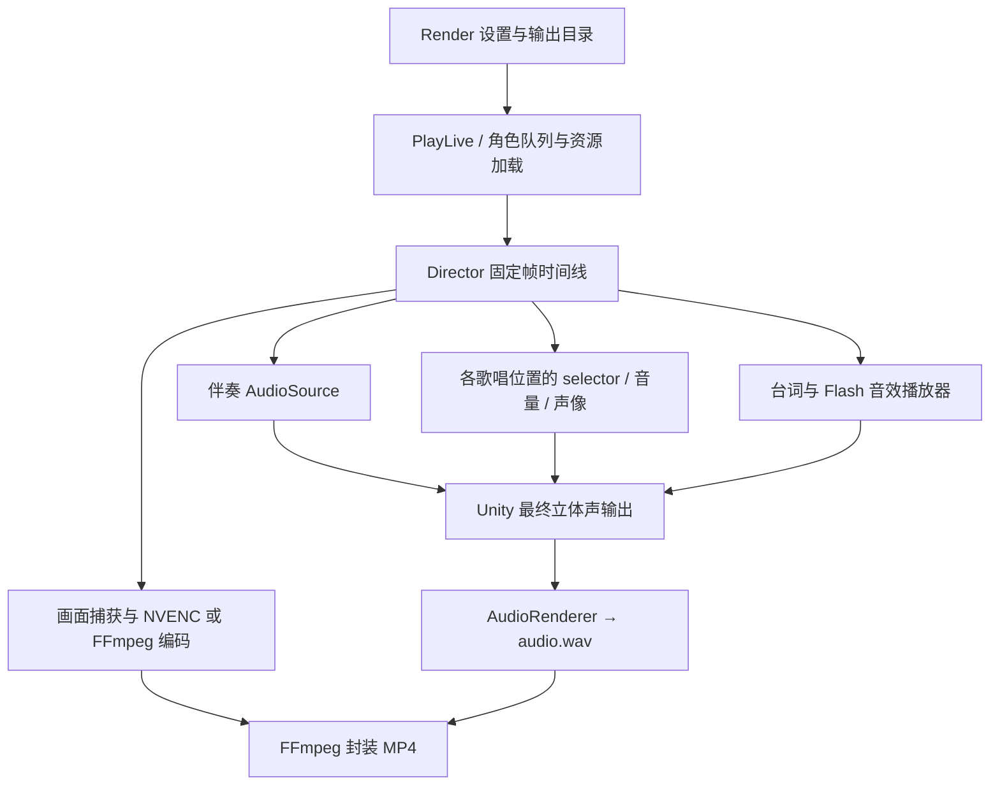

# MKV 与 Live 多音轨渲染调研

调研基线：2.1.48，Unity 2022.3.62f3，Windows x64 / Mono。D2 按“歌唱绑定 × wave”导出，保留 Live 使用区间，音量与声像作为可编辑的轨道处理另存。跨软件限制与素材包建议见 [剪辑音频兼容性](EDITING_AUDIO_COMPATIBILITY.md)。本轮更新调研方案。

## 1. 结论

- 现有视频编码可以继续使用，新增 MKV 主要涉及容器设置、文件名、封装参数与界面。
- 当前音频在 Unity 中已合成为一个立体声输出。独立音轨应从混音前的逻辑音源采集，不能在最终 `audio.wav` 中拆分。
- 音频采用两条支路：每个歌唱绑定的各 wave 独立解码，按演出使用区间写入原幅度采样或静音；总混音继续使用现有 Live 的分句、selector、音量、声像及重复声部规则。
- Mixer 分组录音适合伴奏与附加声音分类，以及总混音对照；已经经过静音和增益处理的分组输出不能恢复完整干音。
- 歌唱轨数量为各有效绑定的 wave 数量之和；各音库 wave 数相同时，即歌唱者数量 × wave 数量。身份按歌唱槽位保留，不按舞台人数或下载数量推算。
- MKV 包含一条默认双声道总混音，另外保存伴奏、wave 干音和已用附加轨；MP4 使用同一总混音源。导出界面选择 MKV 或 MP4，一次输出所选格式。MKV 的独立音轨供选择播放；同时叠加各分轨并还原轨道处理应在剪辑软件中完成。[Matroska 轨道选择规则](https://www.matroska.org/technical/notes.html#track-flags)

## 2. 当前渲染与音频路径



| 环节 | 对应源码与当前行为 |
| --- | --- |
| 渲染界面 | [UmaViewerUI.LiveRender.cs](../Assets/Scripts/UmaViewerUI.LiveRender.cs)：选择分辨率、帧率、码率和编码器，按钮固定为 Render MP4 |
| 输出设置 | [LiveRenderSettings.cs](../Assets/Scripts/LiveRenderSettings.cs)：`FileName` 固定 `.mp4` |
| 帧与音频采集 | [LiveVideoExporter.cs](../Assets/Scripts/LiveVideoExporter.cs)：`Attach` 开始离线音频；`CaptureAudio` 写一个 48 kHz、双声道、float32 WAV；最后固定映射一条音轨并编码 AAC 320 kbps |
| 视频编码 | [LiveGpuVideoEncoder.cs](../Assets/Scripts/LiveGpuVideoEncoder.cs)、[LiveVideoFrameWriter.cs](../Assets/Scripts/LiveVideoFrameWriter.cs)：NVENC 路径生成 TS，其他路径生成临时 MP4，最终复制视频流 |
| 歌唱绑定 | [LiveSongAudioControl.cs](../Assets/Scripts/umamusume/Gallop/Live/LiveSongAudioControl.cs)：`AudioPlan.Voices` 保存歌唱槽位、出演角色、实际声线角色和资源；当前最多七个槽位 |
| 分句和混音 | [UmaViewerAudio.cs](../Assets/Scripts/UmaViewerAudio.cs)：`SwitchActiveSource`、`AlterUpdate`、`NativePartLabels` 决定分句、selector、音量、声像和重复声部处理 |
| 台词 | [LiveVoicePlayback.cs](../Assets/Scripts/umamusume/Gallop/Live/LiveVoicePlayback.cs)、[Director.cs](../Assets/Scripts/umamusume/Gallop/Live/Director.cs)：独立 `LiveVoicePlayer`，按 cue 播放，可使用外部 AWB 或 ACB 内嵌音频 |
| Flash 音效 | [Director.Flash.cs](../Assets/Scripts/umamusume/Gallop/Live/Director.Flash.cs)、[LiveFlashController.cs](../Assets/Scripts/umamusume/Gallop/Live/LiveFlashController.cs)：另一独立播放器，按时间线动作触发 |

### 当前不能直接沿用的做法

`-map 1:a:0` 目前只有一个输入混音，增加几个 `-map` 不会产生独立人声。复制原始 AWB 也不能保留现场分句和混音规则。同一视频帧反复调用 `AudioRenderer.Render` 会重复推进音频处理，不能将它当作逐轨录音接口。

## 3. 已确认的输出约定

### 轨道结构

```text
Video
Audio 0: <Live编号>_总混音                       默认播放
Audio 1: <Live编号>_伴奏
Audio 2: <Live编号>_<实际声线角色名>_01-center_wave01
Audio 3: <Live编号>_<实际声线角色名>_01-center_wave02
Audio 4: <Live编号>_<实际声线角色名>_02-left_wave01
Audio 5: <Live编号>_<实际声线角色名>_02-left_wave02
...
可选:    <Live编号>_VOICE_台词
可选:    <Live编号>_SE_Flash
```

- `n` 的身份与位置取本次 `AudioPlan` 中的有效歌唱绑定。每个绑定为音库中的每条 wave 创建一轨；从未使用的 wave 也保留等长静音轨，以保持轨道结构。固定和动态声部映射见 D2.1。
- 每条轨从视频的时间零点开始，未发声区间写静音，统一时长与采样率，便于拖入剪辑软件后直接对齐。
- 位置编号使用 `Binding.Slot + 1`，方位使用 `PartForm`。当前内部顺序是 `center / left / right / left2 / right2 / left3 / right3`，不是镜头画面中的左右顺序。
- 不能直接用压缩后的 `liveVocal` 列表下标作位置：无音源槽位会被跳过，原槽位应继续保留。
- 角色名使用 master 中实际声线角色的原名；轨道清单另存出演角色 ID、声线角色 ID、槽位、资源名、bank 顺序和实际 wave ID。`wave01` 是一基顺序，不等同于实际 wave ID。字幕或界面语言切换不改变文件内身份。
- 若同一实际声线用于两个位置，仍按位置保存各 wave，名称由位置区分；同时记录当前阵容下的去重和静音状态。
- 只为本次演出使用的附加音频类别创建轨道。台词和 Flash SE 分开，不为每次 cue 创建一条新轨。

轨道名称写入容器的 `title` 元数据，并显式指定音轨映射和默认轨。[FFmpeg 映射与元数据说明](https://github.com/FFmpeg/FFmpeg/blob/master/doc/ffmpeg.texi)

### 干音与总混音的区别

- 干音轨：一轨对应一个歌唱绑定的一条 wave。保留全曲时间坐标，Live 未使用区间写静音，使用区间保留解码后的原幅度采样，不乘入非零播放器增益、不应用声像，不混入其他声源。源素材已有的效果和声道关系保留。
- 音量、声像：另存为轨道参数和随时间变化的自动化，导入素材后再作用于轨道。音量为零也记录为原始参数；分句与 selector 产生的使用门控单独记录。门控判定复用实际播放状态，不能把 Part 标签零直接视为静音。
- 总混音轨：按 Live 时间线选择素材并应用分句、静音、音量、声像、重复声部规则，再与伴奏和其他实际使用的声音混合。
- MKV 音频使用 48 kHz、双声道、FLAC 24-bit；MP4 使用 48 kHz、双声道、AAC 320 kbps 总混音。
- 单个歌手的全部 wave 恢复相应轨道处理后，应对应当前阵容下隔离该角色的演唱；不重新计算成一人阵容。只叠加未处理 WAV 时，内容与时间对齐，响度和声像还需应用曲线。跨软件的声像算法差异见兼容性文档。
- WAV 中写静音保留时间位置，但会丢失该区间的原采样；若需要在软件中取消静音，应额外保留未静音源 wave 与门控数据。该恢复能力与统一时间轴分开列出。

## 4. 已找到的特例

以下 Part 数量来自现有缓存乐谱解析；导出时最终以运行中的 `partInfo` 和冻结后的 `AudioPlan` 为准。

| 特例 | 数据或源码事实 | 对多轨导出的影响 |
| --- | --- | --- |
| 1193 Beyond | 舞台 10 人；主 Part 和 `_part_01` 都启用 `left / center / right` 三个位置；另有 3193 前置拍照演出 | 正常主演出按三个歌唱位置建轨，不能因十人登台或下载了十份人声就生成十条。前置拍照阶段不并入主视频的音频时间轴 |
| 1037 transforming | Part 启用两个位置；center 固定选择标签 1，left 固定选择标签 2；角色音库含两个等长 wave | 两个绑定各建两轨，共四条 vocal；各位置从未选择的 wave 保留为静音轨 |
| 1151 Legend-Changer | 当前 Part 三个歌唱位置；伴奏存在 `oke_01_01`～`oke_01_05` 与 `oke_02` | 导出实际选中的一条伴奏，记录版本；不把备选伴奏当作额外音轨全部装入 |
| 1157 ゆこまロマン純情派 | 当前 Part 四个位置；索引还存在尾部多下划线的 `oke_02_` | 以已经选定的资源实体为准，不在导出阶段重新拼文件名猜版本 |
| 1181 トレセンラーメン列伝 | 当前 Part 六个位置；有按角色、版本选择的 `_vo_*` ACB，部分音频内嵌于 ACB | 台词另归 VOICE；不能将“没有外部 AWB”视为没有音频，也不能把台词算入歌唱槽位 |
| 1095 彩 Phantasia | 当前 Part 没有活跃歌唱位置；有独立 `_vo` 资源，伴奏 cue 存在显式静音规则 | `n` 可以为零；保留 cue 的零音量，避免把原来静音的伴奏重新放响。按实际触发情况输出台词轨 |
| 1152 SHAKEROCK | 当前 Part 没有活跃歌唱位置 | 不按舞台人数虚构 vocal 轨。若某曲的音源本身已经混入人声，独立采集也只能得到该完整音源 |
| 替唱或无音源 | 声线选择会因角色权限、文件缺失而替换；绑定同时保留 `CharacterId` 与 `VoiceCharacterId` | 按实际发声角色命名，另存出演身份；没有可用音库的槽位不计入有效绑定 |
| 同人重复登台 | 当前按 `(资源, part label)` 去重，并保留 selector 的历史状态 | 按槽位保留 wave 轨和处理状态；从未使用的轨可以全静音，轨道数量不因去重改变 |
| Part 的零与默认值 | selector 标签零可能表示保持上次 selector；音量/声像中的默认哨兵与显式零含义不同 | 不把标签零简单解释成停播，不把显式零改成默认音量；复用现有 `AlterUpdate` 结果 |
| 动态台词、Flash SE | 两个播放器按 cue 动态创建和释放 `AudioSource`，新 cue 会替换当前播放器中的旧 cue | 导出期间需持续登记新音源，保留起播偏移、停止与替换行为，不能只在开始时枚举一次 |
| 字幕开关与 Flash SE | 关闭字幕会阻止 Flash SE 触发，并停止当前 Flash SE；普通台词是另一条路径 | 保持当前联动，按本次实际触发情况建立附加轨 |
| Remix | 1079、1100、1101 是 `has_live=0` 的独立 Jukebox 音频，没有同编号 Live 分轨 | 不扩展为本轮普通 Live 的 Remix 选择功能，也不将其识别为某个角色的独立 vocal |

## 5. 实施方案与工程验证点

### 总混音与附加音轨：一次音频推进，同时录制 Mixer 组

Unity 2022.3 的 `AudioRenderer.Render` 可以同时录制主输出与登记的 Mixer 组。[官方 Render 文档](https://docs.unity3d.com/2022.3/Documentation/ScriptReference/AudioRenderer.Render.html)

`AddMixerGroupSink(AudioMixerGroup, NativeArray<float>, bool)` 是 internal 接口。已读取本机 2022.3.62f3 的 Editor 与 Windows 非开发 Mono Player 程序集，两者都包含该签名；官方对应分支也给出了该声明。[Unity 2022.3 绑定源码](https://raw.githubusercontent.com/Unity-Technologies/UnityCsReference/2022.3/Modules/Audio/Public/ScriptBindings/AudioRenderer.bindings.cs)

建议流程：

1. 冻结 `AudioPlan` 与轨道清单，固定实际声线身份、槽位和资源。总混音继续使用原歌唱播放器；为伴奏、台词和 Flash SE 准备分类 Mixer 组，组增益保持 0 dB。
2. 将需要分类录制的现有音源路由至对应组。歌唱播放器继续由原代码控制分句、selector、音量、声像与去重；动态台词与音效在创建时登记。
3. 通过单独的引擎接口适配层绑定 internal 方法，注册分类缓冲；每个采样周期只推进一次 `AudioRenderer.Render`，取得主混音与已登记类别的同一时间窗口。
4. 逐块写出分类临时文件和总混音，保持统一采样计数。渲染结束后，MKV 显式映射总混音、伴奏、wave 干音和附加类别；MP4 只映射总混音。两者都复制已有视频流。
5. 结束或取消时恢复音源原路由，释放录音缓冲。视频编码、CySpring 与角色队列的现有流程继续复用。

开工后的首项可运行验证：在 Windows Player 中检查 sink 的登记生命周期、缓冲长度、声道顺序、音量和声像采集位置，以及 `excludeFromMix=false` 时主输出与分轨是否符合预期。项目目前没有现成的 `.mixer` 资源，需要新增专用 Mixer 资源。

### vocal wave 干音：独立解码与使用门控

复用 `UmaWaveStream` 的音频解码能力，为干音导出创建独立解码流，逐块读取相应角色的完整素材。该流与播放流分别持有游标，避免干音导出的 seek/read 改变正在播放的音频位置。

每个绑定的所有 wave 使用同一时间原点逐块解码；依据 selector 和实际使用区间，当前使用的 wave 写原幅度采样，其他 wave 写零，时间不压缩。素材不足时补零，超出统一输出长度的部分裁切。门控只是零或一，非零音量与声像不乘入干音采样；处理参数另写自动化数据。最终 MKV 按 FLAC 24-bit 编码。

门控与自动化在原 `AlterUpdate` 解析结果处记录，保留 selector 历史、显式零、默认音量、声像、音量率和去重来源，避免另写一套不同的 Part 解释器。不能简单测试 `Part label > 0`：标签零仍可能沿用上次 selector，且显式非零音量仍可能使其发声。源采样自身的静音也不能用来推断是否使用。

跨软件编辑建议增加可选独立 WAV 素材包与 JSON/CSV 轨道处理数据；这是对现有 MKV/MP4 选择的补充，不自动输出第二份视频。软件专用自动化导入器的范围与限制见兼容性文档。

`OnAudioFilterRead` 可作为备选采集点，但当前一个 GameObject 上可能挂多个 `AudioSource`，而且回调位于音频线程。采用它之前需验证音源归属、采样点与增益顺序，回调中不直接执行文件写入或调用主线程 API。[Unity 音频滤镜说明](https://docs.unity3d.com/2022.3/Documentation/ScriptReference/MonoBehaviour.OnAudioFilterRead.html)

### MKV 封装

新增容器设置，统一处理文件扩展名、临时成品名和界面文案；`faststart` 仅用于 MP4。NVENC 的 TS 和现有临时 MP4 都可以作为视频输入，最终继续 `-c:v copy`，不增加一次视频编码。

封装结构示意：

```text
输入：video.ts 或 video.mp4、bgm.wav、vocal01.wav、vocal02.wav、按需生成的附加音频
映射：一个视频流、默认总混音、伴奏、按槽位及 wave 顺序排序的人声、已使用的附加音频
元数据：每条音轨分别设置 title；完整身份、处理曲线及门控区间另存轨道清单
输出：complete.mkv → 最终文件
```

### 本轮已经完成的封装能力试验

- 本机 FFmpeg 已生成一秒合成 MKV：H.264 视频 + 四条独立 AAC 音轨，中文轨道名、歌唱位置名称与 default 标记经 ffprobe 确认保留。
- 另生成了 H.264 + 48 kHz、双声道、24-bit FLAC 的 MKV，音视频起点均为零、时长均为一秒。
- AAC 合成样本的音频起始 PTS 为约 -21 ms，FLAC 样本为零。实施中要处理编码延迟和采样长度，不能只比较容器总时长。

### 预计涉及的源码

| 位置 | 工作 |
| --- | --- |
| `LiveRenderSettings.cs`、`UmaViewerUI.LiveRender.cs` | 容器、音频方案与界面信息 |
| `LiveVideoExporter.cs` | 多轨生命周期、同步采样、临时文件与最终封装 |
| `UmaViewerAudio.cs` | 保留总混音的分句与混音规则；为分类采集登记音源 |
| `LiveSongAudioControl.cs`、`Director.cs` | 冻结身份与槽位映射，传递歌唱绑定 |
| `LiveVoicePlayback.cs`、`Director.Flash.cs` | 动态台词与 SE 的分类和路由 |
| 新增轨道清单、干音解码写入、Mixer 采集适配层和 Mixer 资源 | 分开保存门控 wave、轨道处理与演出混音，集中管理身份、缓冲与路由 |

首轮验收覆盖：1193 的三个单 wave 绑定；1037 的四条 vocal（含未选择 wave 的静音轨）；1059 三 wave 动态切换；同角色重复与替唱；1095/1152 零歌唱位置；1151 伴奏变体；1181 内嵌台词；字幕关闭时的 SE；MP4 与 MKV。对照源解码结果检查使用区间采样幅度、声道未被非零增益或声像改写；检查未使用区间为零且时长未压缩。自动化独立编辑，主混音与现有 Live 对照。另检查采样长度、名称、默认标记和角色全部 wave 的组合试听。

## 6. 已确认的输出规则

| 编号 | 项目 | 已确认规则 |
| --- | --- | --- |
| D1 | MKV 轨道组成 | 默认双声道总混音 + 一条伴奏 + 各绑定的全部 wave 轨 + 本次实际使用的附加声音 |
| D2 | vocal 内容 | 各绑定 × wave；Live 未使用区间静音且保留时间；非零音量与声像作为轨道处理另存，不烘焙进干音采样 |
| D3 | 替唱命名 | 实际声线角色原名 + 歌唱位置；出演角色另存元数据 |
| D4 | 附加声音 | 台词、Flash SE 按来源分组，只输出已用类别，保留当前字幕与 Flash SE 联动 |
| D5 | 编码 | MKV 使用 48 kHz 双声道 FLAC 24-bit；MP4 总混音使用 AAC 320 kbps |
| D6 | 输出方式 | 界面选择 MKV 多轨或 MP4 双声道总混音；一次输出所选格式，不默认同时生成两份视频 |

## 7. D2.1：wave 与歌唱位置的对应关系

对现有缓存的角色音库读取 AFS2 目录后，发现 652 个音库含多个 wave，分布在 26 首歌曲中：648 个音库含两条、4 个含三条。例子包括 1012 グロウアップ・シャイン！、1032 ユメヲカケル！、1037 transforming，以及具有三条素材的 1059 Overrunner!。1193 已检查的角色音库为单 wave。

### 对照结论

wave 与歌唱位置之间通过 Part 表关联，而不是仅凭 wave 编号固定绑定。26 首歌曲的默认 Part 中：

- **1037、1175 两首**：每个有效位置始终选择同一个标签，属于固定声部映射。
- **其余 24 首**：至少有一个位置会随时间切换标签；同一个标签也可能用于不同位置。

通用关系是 **角色音库提供声部，Part 表把声部分配给各歌唱位置**。为剪辑保留每条素材的独立身份，按每个绑定分别导出所有 wave，并记录该绑定的时间选择。

| 曲目 | 实际 Part 对照 | wave 时间轴 |
| --- | --- | --- |
| 1037 transforming | 整首 center=1、left=2 | 两个 wave 都是 180 秒；该样本标签 1/2 分别选择 bank 顺序中的 wave ID 0/1 |
| 1012 グロウアップ・シャイン！ | 24.000 秒 left=2、center=1；35.834 秒 center=2、right=1 | 两个 wave 都是 144 秒；标签 2 随时间在 left、center 位置使用 |
| 1032 ユメヲカケル！ | left、right 使用标签 1；center 会在 1、2 间切换 | 两个 wave 都是 158 秒；不是三个位置各自固定占用一个 wave |
| 1059 Overrunner! | 103.000 秒 left2=3、left=2、center=1、right=3 | 三个 wave 都是 152 秒；四个有效位置可同时使用三个声部，标签 3 被两个位置使用 |
| 1195 繚乱縁舞 | 六个有效位置使用两个标签，多个位置随时间切换 | 两个 wave 都是 134 秒 |

播放代码与数据吻合：

1. `UmaViewerBuilder.LoadAudio` 为一个角色 bank 的各 wave 分别创建 AudioClip。
2. `LiveSongAudioControl.Start` 将所有 clip 按同一个 DSP 起点启动，使声部保持整首同步。
3. `UmaViewerAudio.AlterUpdate` 读取各位置在当前时间的 Part 标签。
4. `SwitchActiveSource` 根据标签选择对应 clip，其他 clip 静音；音量、声像与重复声部处理再单独执行。

### 按绑定 × wave 建轨

- 1037：2 个绑定 × 2 条 wave = 4 条 vocal。
- 1012、1032：3 个绑定 × 2 条 wave = 6 条 vocal。
- 1059：4 个绑定 × 3 条 wave = 12 条 vocal。
- 1195：6 个绑定 × 2 条 wave = 12 条 vocal。
- 1193：3 个绑定 × 1 条 wave = 3 条 vocal。
- 以上数量以本次绑定均有可用音库、wave 数量与已查样本一致为条件；音库数量不同则逐绑定求和。
- 动态切换只改变各 wave 在相应时间区间的使用状态，不拼成一条混合素材，也不重新从零开始播放 wave。
- 音量和声像在轨道导入之后作为可编辑处理恢复；原始处理曲线独立于门控音频保存。各软件的恢复方式与限制见 [剪辑音频兼容性](EDITING_AUDIO_COMPATIBILITY.md)。

当前处于调研与方案讨论阶段，渲染实现保持原状。
